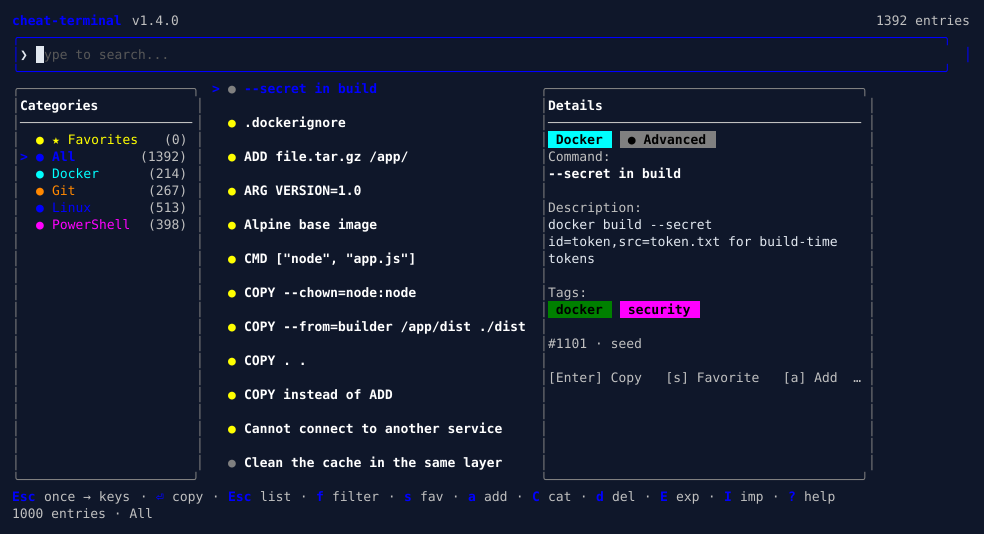
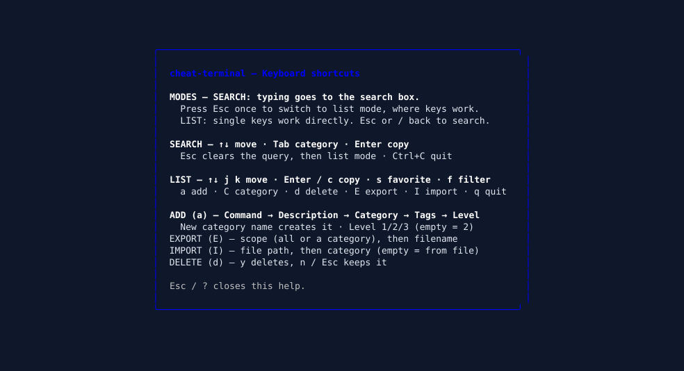
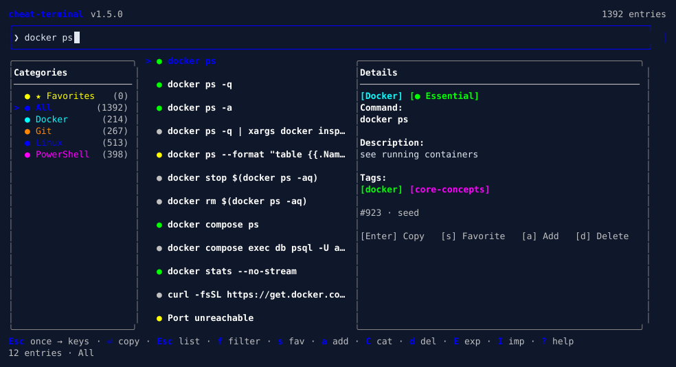
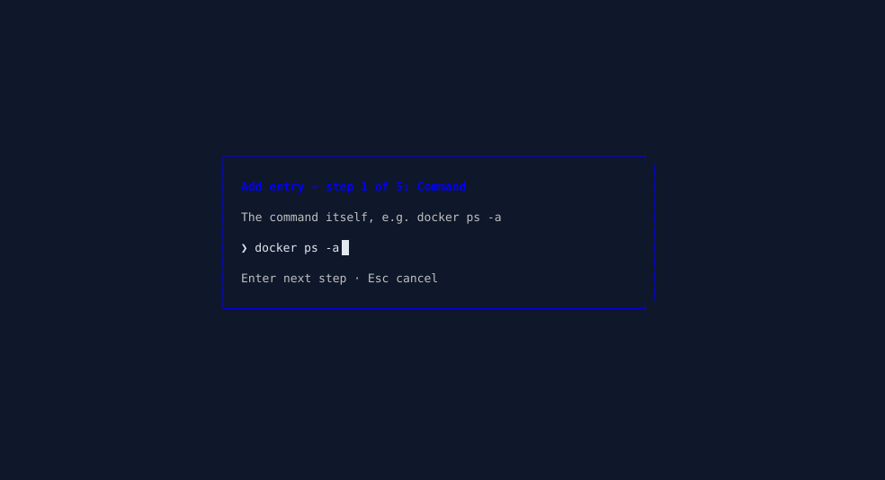

# cheat-terminal

چیت‌شیت‌هات رو از توی ترمینال جست‌وجو کن. یه دیتابیس SQLite سریع و
دسته‌بندی‌شده از دستورها، با پیشنهاد زنده موقع تایپ، یه مرورگر
تمام‌صفحه، و یه CLI کوچیک برای جست‌وجو و ویرایش. روی هر ترمینالی کار
می‌کنه — ویندوز ترمینال، ترمینال مک، ترمینال‌های لینوکس، tmux — فقط با
۱۶ رنگ ANSI، بدون تروکالر و بدون فونت خاص.



## چیه

- **۱۳۹۲ دستور** از روز اول: لینوکس، پاورشل، داکر، گیت
- **جست‌وجوی زنده** با پیشنهاد تمام‌متن موقع تایپ
- **یه مرورگر واقعی**: سایدبار دسته‌ها، نتایج زنده، و یه پنل جزئیات که
  دستور انتخاب‌شده رو کامل نشون می‌ده. یه فلش `>` پررنگ ردیف انتخاب‌شده
  رو نشون می‌ده و با حرکت مکان‌نما جابه‌جا می‌شه؛ هر دسته رنگ خودش رو
  داره
- **کپی** هر دستور به کلیپ‌بورد با یه کلید (Enter)
- **فیلتر بر اساس کاربردی بودن**: ضروری، معمولی یا پیشرفته — همه دستورها
  رتبه‌بندی شدن، پس فقط همون‌هایی رو می‌بینی که مهم‌ن
- **علاقه‌مندی‌ها**: دستورهایی که بیشتر استفاده می‌کنی رو ستاره‌دار کن، همه‌شون یه جا جمع می‌شن
- **دستورهای خودت**: از داخل مرورگر اضافه‌شون کن، دسته خودت رو بساز،
  چیزی که نمی‌خوای رو حذف کن. به‌روزرسانی سید هیچ‌وقت بهشون دست نمی‌زنه
- **اکسپورت و ایمپورت**: دستورهات رو به صورت فایل JSON خروجی بگیر، بده
  به یه هوش مصنوعی تا توضیحات رو کامل‌تر کنه و دستورهای کم‌شده رو اضافه
  کنه، دوباره واردش کن
- **یه باینری استاتیک، یه فایل دیتابیس** (`cheats.db`)، بدون نصب، بدون شبکه

## نصب

باینری سیستم‌عاملت رو از صفحه [Releases](../../releases) بگیر (لینوکس،
ویندوز، مک)، یا خودت بسازش:

```sh
git clone https://github.com/erffanhub-00/cheat-terminal.git
cd cheat-terminal
go build -o cheat-terminal .
```

برای ساختن Go نسخه 1.25 یا جدیدتر لازمه. خود باینری موقع اجرا به هیچ‌چیز
دیگه‌ای نیاز نداره: نه CGO، نه فایل تنظیمات، نه شبکه.

توی ویندوز روی فایل `.exe` دابل‌کلیک کن — پنجره کنسول خودش رو باز
می‌کنه و کامل می‌گیره‌ش. توی لینوکس و مک از هر ترمینالی اجراش کن.

## شروع سریع

بدون آرگومان اجراش کن تا مرورگر تعاملی باز بشه:

```sh
./cheat-terminal
```

اولین اجرا `cheats.db` رو کنار باینری می‌سازه و با ۱۳۹۲ دستور سید
پرش می‌کنه. تایپ کن برای جست‌وجو، Enter بزن تا دستور به کلیپ‌بورد کپی
بشه، هر جا خواستی paste کن، با `q` خارج شو.

مرورگر توی **حالت جست‌وجو** باز می‌شه: هر چی تایپ کنی می‌ره توی باکس
جست‌وجو. برای استفاده از کلیدهای تک‌حرفی (کپی، ستاره، اضافه کردن، ...)
اول **یه بار Esc بزن** — می‌ره به **حالت لیست**. پایین صفحه همیشه
نوشته شده.

## کلیدها

| کلید | کارش |
| --- | --- |
| تایپ | جست‌وجو (زنده، تمام‌متن) |
| `↑` / `↓` | حرکت دادن انتخاب |
| `PgUp` / `PgDn` | حرکت یه صفحه |
| `Tab` / `Shift+Tab` | عوض کردن دسته |
| `Enter` | کپی دستور انتخاب‌شده (توی هر دو حالت کار می‌کنه) |
| `Esc` | پاک کردن جست‌وجو، بعد رفتن به حالت لیست |
| `?` | نشون دادن همه کلیدها |
| `Ctrl+C` | خروج |

توی **حالت لیست** (بعد از یه بار Esc)، این کلیدها هم کار می‌کنن:

| کلید | کارش |
| --- | --- |
| `Enter` / `c` | کپی دستور انتخاب‌شده |
| `s` | ستاره‌دار / حذف ستاره |
| `f` | فیلتر بر اساس کاربردی بودن (همه ← ضروری ← معمولی ← پیشرفته) |
| `a` | اضافه کردن دستور جدید (قدم‌به‌قدم) |
| `C` | اضافه کردن دسته جدید |
| `d` | حذف دستور انتخاب‌شده (اول می‌پرسه) |
| `E` | اکسپورت دستورها به فایل JSON |
| `I` | ایمپورت دستورها از فایل JSON |
| `/` | برگشت به جست‌وجو |
| `q` | خروج |



## جست‌وجو



فقط شروع کن به تایپ کردن — نتایج موقع تایپ فیلتر می‌شن، توی دستور،
توضیح، تگ و دسته جست‌وجو می‌شه. با `↑` / `↓` انتخاب رو جابه‌جا کن، با
`Tab` دسته رو عوض کن، با `Enter` دستور رو کپی کن.

باکس جست‌وجو همیشه نقطه شروعه: مرورگر توی حالت جست‌وجو باز می‌شه. اگه
یه کلید به نظر می‌رسه کار نمی‌کنه و فقط توی باکس تایپ می‌شه، توی حالت
جست‌وجویی — **یه بار Esc بزن** تا کلیدها کار کنن. پایین صفحه نوشته شده:
`Esc once → keys work`.

برای پاک کردن چیزی که تایپ کردی، `Esc` بزن — اولین Esc جست‌وجو رو پاک
می‌کنه، دومی (وقتی جست‌وجو خالیه) می‌ره به حالت لیست.

## فیلتر بر اساس کاربردی بودن

توی حالت لیست `f` رو بزن تا فیلتر بچرخه: همه ← ضروری ← معمولی ←
پیشرفته. همه دستورها رتبه‌بندی شدن، پس وقتی فقط دستورهای روزمره رو
می‌خوای می‌تونی پیشرفته‌ها رو مخفی کنی، یا فقط ضروری‌ها رو ببینی.

فیلتر فعال توی هدر به صورت یه برچسب نشون داده می‌شه. همون فیلتر از خط
فرمان هم هست: `--level essential|common|advanced`.

## علاقه‌مندی‌ها

توی حالت لیست `s` رو بزن تا دستور انتخاب‌شده ستاره‌دار بشه (یا ستاره‌ش
برداشته بشه). دستورهای ستاره‌دار توی ردیف **★ Favorites** بالای سایدبار
جمع می‌شن، پس دستورهایی که واقعاً استفاده می‌کنی همیشه یه Tab فاصله
دارن.

## اضافه کردن دستورهای خودت

توی حالت لیست `a` رو بزن تا یه فرم قدم‌به‌قدم باز بشه:

1. **دستور** — خود دستور، مثلاً `docker ps -a` (اجباریه)
2. **توضیح** — کارش چیه، با چند کلمه (اختیاری)
3. **دسته** — یه دسته موجود، یا یه اسم جدید تا همون دسته ساخته بشه
4. **تگ** — با کاما جدا کن، مثلاً `containers, list` (اختیاری)
5. **سطح** — ۱ ضروری، ۲ معمولی، ۳ پیشرفته (خالی = معمولی)

Enter می‌ره به مرحله بعد، Esc توی هر مرحله‌ای لغو می‌کنه. بعد از ذخیره،
مرورگر می‌ره روی دستور جدید توی دسته خودش.



## دسته‌ها

سایدبار همه دسته‌ها رو با تعداد دستورهاشون نشون می‌ده. با `Tab` و
`Shift+Tab` بین‌شون جابه‌جا شو؛ هر دسته رنگ خودش رو داره، و دسته‌هایی
که خودت می‌سازی رنگ بعدی رو از پالت می‌گیرن.

برای اضافه کردن دسته، توی حالت لیست `C` رو بزن — یه اسم تایپ کن و توی
سایدبار ظاهر می‌شه. تایپ کردن اسم دسته جدید توی مرحله ۳ فرم اضافه کردن
هم همون دسته رو می‌سازه. اسم دسته‌ها به بزرگی و کوچیکی حروف حساس
نیستن (`Linux` و `linux` یه دسته‌ن).

## حذف کردن

توی حالت لیست `d` رو بزن تا دستور انتخاب‌شده حذف بشه. اول می‌پرسه —
`y` بزن برای حذف، `n` یا `Esc` برای نگه داشتن. این هم برای دستورهای
خودت کار می‌کنه هم برای دستورهای سید.

## اکسپورت و ایمپورت

برای اکسپورت `E` رو بزن، برای ایمپورت `I` رو. هر دو فایل JSON با فرمت
سید هستن (`{"version": 1, "categories": [...], "entries": [...]}`)، پس
راحت برمی‌گردن توی برنامه.

**اکسپورت (`E`) دو مرحله‌ست:**

1. **محدوده** — `all` رو تایپ کن (یا فقط Enter بزن) برای همه، یا اسم
   یه دسته رو برای فقط همون دسته
2. **اسم فایل** — اسم پیشنهادی برای همه دستورها `cheats-export.json`
   هست، برای یه دسته `cheats-<category>.json` (مثلاً
   `cheats-docker.json`)؛ می‌تونی مسیر دیگه‌ای تایپ کنی یا Enter بزنی
   تا همون قبول بشه

**ایمپورت (`I`) دو مرحله‌ست:**

1. **فایل** — مسیر فایل JSON با فرمت سید
2. **دسته** — اسم یه دسته جدید یا موجود، یا خالی تا از دسته‌های خود
   فایل استفاده بشه

ایمپورت سه تا عدد گزارش می‌ده: **جدید** (دستورهای اضافه‌شده)، **به‌روز**
(دستورهای موجود که اطلاعاتشون کامل‌تر شد) و **بدون‌تغییر** (دستورهایی
که از قبل بودن). یه دستور موجود فقط وقتی به‌روز می‌شه که فایل اطلاعات
کامل‌تری داشته باشه — توضیح طولانی‌تر، تگ، یا سطح ۱ تا ۳ — پس ایمپورت
کردن دوباره همون فایل امنه.

### گردش کار با هوش مصنوعی

اکسپورت و ایمپورت دقیقاً برای این ساخته شدن:

1. با `E` یه دسته (یا همه) رو به فایل خروجی بگیر
2. فایل رو بده به یه هوش مصنوعی و ازش بخواه دستورهای کم رو پیدا کنه و
   توضیحات رو کامل‌تر بنویسه
3. با `I` فایل رو برگردون توی برنامه — توی همون دسته، یا یه دسته جدید

دستورهای جدید اضافه می‌شن، توضیحات کامل‌تر جایگزین توضیحات کوتاه
می‌شن، و ایمپورت دقیقاً می‌گه چندتا از هر کدوم اتفاق افتاد.

همین کار از خط فرمان هم می‌شه:

```sh
./cheat-terminal export my.json --category docker
./cheat-terminal import my.json --category docker
```

## مرجع خط فرمان

هر کاری که مرورگر می‌کنه از خط فرمان هم می‌شه. بدون آرگومان برنامه
مرورگر رو باز می‌کنه؛ با آرگومان یه دستور رو اجرا می‌کنه و خارج می‌شه.

```sh
./cheat-terminal docker ps        # چاپ دستورهای مطابق
./cheat-terminal docker ps --level essential   # فقط دستورهای ضروری
./cheat-terminal --list           # دسته‌ها با تعداد دستورها
./cheat-terminal --list docker    # همه دستورهای داکر
./cheat-terminal --favorites      # دستورهای ستاره‌دار خودت
./cheat-terminal favorite 42      # ستاره‌دار کردن دستور شماره ۴۲
./cheat-terminal unfavorite 42    # حذف ستاره دستور شماره ۴۲
./cheat-terminal add              # اضافه کردن دستور خودت (با سوال)
./cheat-terminal edit 42          # ویرایش دستور شماره ۴۲
./cheat-terminal delete 42        # حذف دستور شماره ۴۲ (اول می‌پرسه)
./cheat-terminal category add kubernetes
./cheat-terminal export           # اکسپورت همه دستورها به cheats-export.json
./cheat-terminal export my.json --category docker
./cheat-terminal import my.json   # ایمپورت، با تعداد جدید / به‌روز / بدون‌تغییر
./cheat-terminal import my.json --category kubernetes
./cheat-terminal --import data/   # ایمپورت فایل‌های سید JSON
./cheat-terminal --db <path>      # استفاده از فایل دیتابیس دیگه
./cheat-terminal --version        # چاپ نسخه
./cheat-terminal --help           # همه‌چیز
```

`--level essential|common|advanced` با جست‌وجو، `--list` و
`--favorites` کار می‌کنه. خروجی پایپ‌شده متن ساده‌ست (بدون رنگ)؛ توی
ترمینال دستور پررنگ و توضیح کم‌رنگ چاپ می‌شه.

## دیتابیس

اولین اجرا `cheats.db` رو کنار باینری می‌سازه (یا اگه اون پوشه
قابل‌نوشتن نباشه، توی پوشه تنظیمات کاربر) و با دیتای سید پرش می‌کنه:
۱۳۹۲ دستور در ۴ دسته. جاش رو می‌تونی با `--db <path>` یا متغیر محیطی
`CHEAT_TERMINAL_DB` عوض کنی.

دستورها، دسته‌ها و علاقه‌مندی‌های خودت توی همون فایل ذخیره می‌شن و
به‌روزرسانی سید هیچ‌وقت بهشون دست نمی‌زنه. دیتابیس‌هایی که با نسخه
1.0.0 ساخته شدن، با اولین اجرای نسخه 1.1.0 خودشون به‌روز می‌شن (ستون‌های
جدید اضافه می‌شن و سطح‌های سید پر می‌شن). نسخه 1.2.0، 1.3.0 و 1.4.0 به
هیچ تغییر دیتابیسی نیاز ندارن: یه `cheats.db` قدیمی همون‌جوری کار
می‌کنه — باینری رو عوض کن، فایل دیتابیس رو نگه دار.

برای بکاپ گرفتن، `cheats.db` رو یه جای امن کپی کن. همین کل دیتابیسه.

## تمام‌صفحه و واکنش‌گرا

مرورگر تمام‌صفحه اجرا می‌شه: ترمینال رو کامل می‌گیره (alt-screen)،
عنوان تب ترمینال رو می‌ذاره `cheat-terminal`، و موقع خروج صفحه شِل
برمی‌گرده. چیدمان با اندازه ترمینال سازگاره، از ۶۰×۲۰ تا ۱۶۰×۴۰ و
بزرگ‌تر: توی صفحه‌های باریک سایدبار مخفی می‌شه (هدر اسم دسته فعال رو
نشون می‌ده)، توی صفحه‌های کوچیک پنل جزئیات مخفی می‌شه، و پایین صفحه
همیشه اندازه عرض ترمیناله.

همه رنگ‌ها رنگ‌های ساده پالت ANSI هستن — بدون تروکالر، بدون فونت خاص —
پس مرورگر توی ویندوز ترمینال، ترمینال مک، ترمینال‌های لینوکس، و داخل
tmux یا screen یک‌شکل دیده می‌شه.

## سوال‌های رایج / رفع اشکال

**کلیدها کار نمی‌کنن — تایپ فقط می‌ره توی باکس جست‌وجو.**
توی حالت جست‌وجویی. **یه بار Esc بزن** تا بری به حالت لیست، اون‌جا
کلیدهای تک‌حرفی کار می‌کنن. پایین صفحه نوشته شده.

**کپی کار نمی‌کنه / "Copy failed".**
کپی به کلیپ‌بورد سیستم نیاز داره. مک (`pbcopy`) و ویندوز بدون نصب چیز
اضافه‌ای کار می‌کنن. توی لینوکس `xclip` یا `xsel` رو نصب کن (یا
`wl-copy` برای Wayland)، بعدش کپی کار می‌کنه.

**دیتابیسم کجاست؟**
کنار باینری، توی فایلی به اسم `cheats.db`. با `--db <path>` (یا
`CHEAT_TERMINAL_DB`) می‌تونی جاش رو عوض کنی. برای بردن به یه کامپیوتر
دیگه، باینری و `cheats.db` رو کپی کن.

**فایل اکسپورت کجا رفت؟**
هر جایی که تایپ کردی: پیش‌فرض `cheats-export.json` توی همون پوشه‌ایه
که برنامه رو ازش اجرا کردی (برای یه دسته: `cheats-<category>.json`).

**علاقه‌مندی‌هام توی اکسپورت نیستن.**
درسته — فرمت سید جایی برای علاقه‌مندی‌ها نداره، پس اکسپورت نمی‌شن.
توی `cheats.db` خودت سر جاشون می‌مونن.

**چیدمان به‌هم‌ریخته / متن بد می‌پیچه.**
اندازه پنجره ترمینال رو عوض کن — چیدمان از ۶۰×۲۰ به بالا سازگاره. اگه
هنوز یه خط بد دیده می‌شه، ممکنه ترمینالت فونت غیرمونواسپیس استفاده
کنه؛ عوضش کن به یه فونت مونواسپیس.

**یه فایل رو ایمپورت کردم و هیچی عوض نشد.**
ایمپورت `0 new, 0 updated, N unchanged` گزارش می‌ده وقتی همه دستورها
از قبل بودن و اطلاعاتشون حداقل به همون کاملی بود. یه توضیح رو طولانی‌تر
کن (یا دستور جدید اضافه کن) و دوباره ایمپورت کن.

## توسعه

```sh
go test ./...   # تست‌های واحد (دیتابیس، جست‌وجو، CRUD، ایمپورت، TUI)
go vet ./...    # بررسی‌های استاتیک
```

CI روی vet و تست‌ها اجرا می‌شه و باینری لینوکس، ویندوز و مک رو از
`.github/workflows/ci.yml` می‌سازه. (اپ گیت‌هابی که برای پوش استفاده
می‌شه نمی‌تونه فایل ورک‌فلو بسازه، پس اون فایل از روی سایت مدیریت
می‌شه.)

## دیتای سید

دستورهای سید توی `data/seed.json` هستن که با `tools/generate-seed.py` از
چیت‌شیت‌های انگلیسی (گیت، لینوکس، پاورشل، داکر) ساخته شدن:

```sh
python3 tools/generate-seed.py
./cheat-terminal --import data/
```

ایمپورت فقط رکوردهای سید رو به‌روز می‌کنه. دستورهای خودت جدا ذخیره
می‌شن (`source = 'user'`) و ایمپورت هیچ‌وقت تغییرشون نمی‌ده یا پاکشون
نمی‌کنه. همون فرمت JSON برای `export` و `import` هم استفاده می‌شه.

## لایسنس

MIT — ببین [LICENSE](LICENSE).

## Me
[](https://t.me/erffan_hub)
[](https://x.com/Erffanhub_00)
[](https://gist.github.com/erffanhub-00)
[](https://github.com/erffanhub-00)
