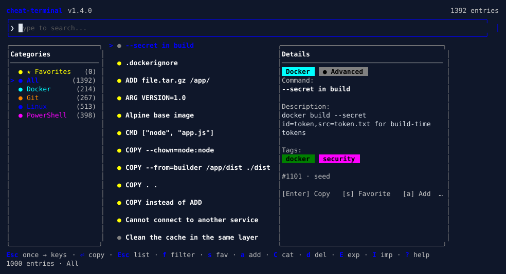
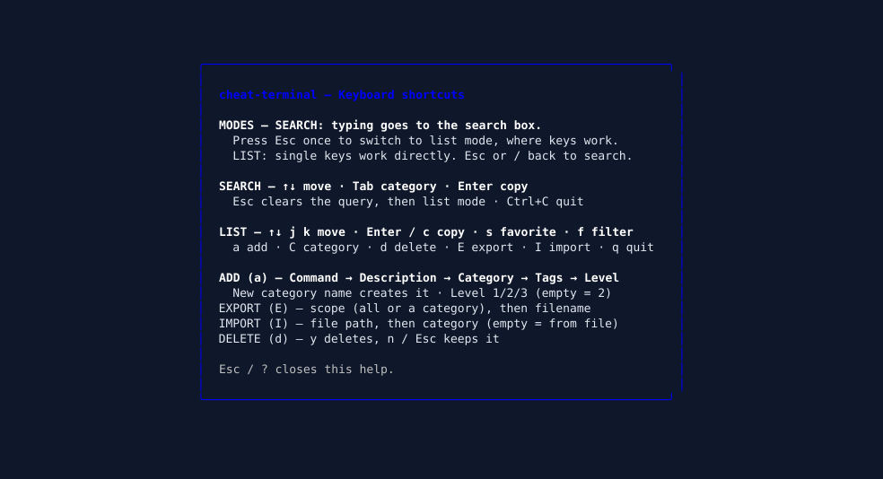
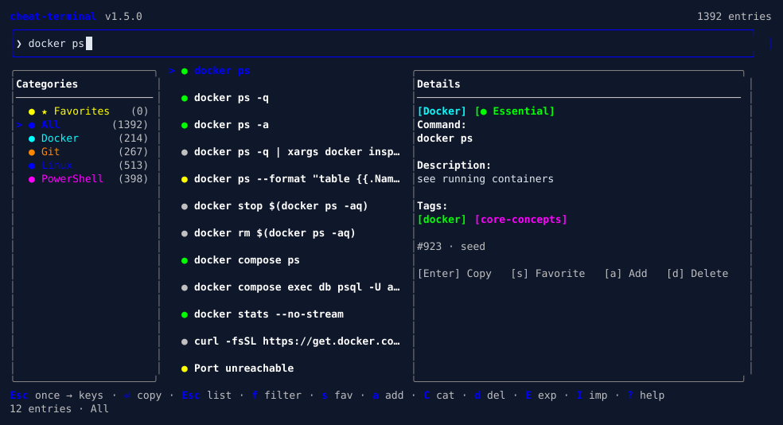
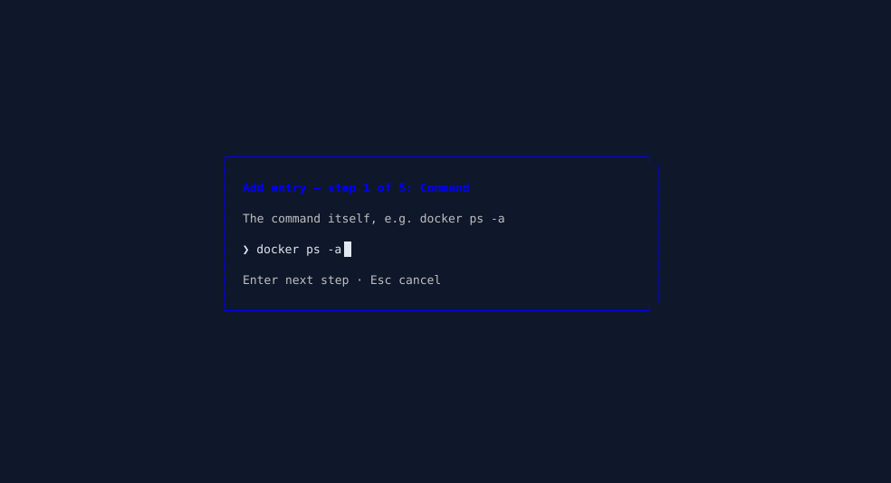

# cheat-terminal

Search your cheat sheets from the terminal. A fast, categorized SQLite
database of commands with live suggestions while you type, a full-screen
browser, and a small CLI for searching and editing. It works on any
terminal — Windows Terminal, macOS Terminal, Linux terminals, tmux —
using only the 16 ANSI colors, no truecolor, no special fonts.



## What it is

- **1392 commands** seeded from day one: Linux, PowerShell, Docker, Git
- **Live search** with full-text suggestions as you type — partial
  words match while you type (`dock` finds `docker`), punctuation
  never breaks it (`docker ps -a`, `ps | grep`), and the best match
  comes first: the exact command, then command matches, then
  description and tag matches
- **A real browser**: category sidebar, live results, and a roomy
  detail pane (about 45% of the width) showing the selected command in
  full. A bold `>` arrow marks the selected row and moves with the
  cursor; every category has its own color
- **Copy** any command to the clipboard with one key (Enter)
- **Filter by usefulness**: Essential, Common or Advanced — every
  command is rated, so you can see only the ones that matter
- **Favorites**: star the commands you use most, find them in one place
- **Your own entries**: add them inside the browser, make your own
  categories, delete what you don't need. Seed updates never touch them
- **Export & import**: write your commands to a JSON file, give it to
  an AI to enrich descriptions and add missing commands, import it back
- **One static binary, one database file** (`cheats.db`), no install, no
  network

## Install

Download the binary for your OS from the [Releases](../../releases)
page (Linux, Windows, macOS), or build it yourself:

```sh
git clone https://github.com/erffanhub-00/cheat-terminal.git
cd cheat-terminal
go build -o cheat-terminal .
```

Requires Go 1.25 or newer to build. The binary needs nothing else at
runtime: no CGO, no config files, no network.

On Windows, just double-click the `.exe` — it opens its own console
window and takes it over. On Linux and macOS, run it from any terminal.

## Quick start

Run it with no arguments for the interactive browser:

```sh
./cheat-terminal
```

The first run creates `cheats.db` next to the binary and fills it with
the 1392 seeded commands. Type to search, press Enter to copy a command
to the clipboard, paste it wherever you need it, press `q` to quit.

The browser opens in **search mode**: whatever you type goes into the
search box. To use the single-key actions (copy, favorite, add, ...),
press **Esc once** first — that switches to **list mode**. The footer
always says so.

## Keys

| Key | What it does |
| --- | ------------ |
| Type | Search (live, full-text) |
| `↑` / `↓` | Move the selection |
| `PgUp` / `PgDn` | Move a page |
| `Tab` / `Shift+Tab` | Switch category |
| `Enter` | Copy the selected command (works in both modes) |
| `Esc` | Clear the query, then switch to list mode |
| `?` | Show all shortcuts |
| `Ctrl+C` | Quit |

In **list mode** (after one Esc), these keys also work:

| Key | What it does |
| --- | ------------ |
| `Enter` / `c` | Copy the selected command |
| `s` | Star / unstar a favorite |
| `f` | Filter by usefulness (All → Essential → Common → Advanced) |
| `a` | Add a new entry (step by step) |
| `C` | Add a new category |
| `d` | Delete the selected entry (asks first) |
| `E` | Export entries to a JSON file |
| `I` | Import entries from a JSON file |
| `/` | Back to search |
| `q` | Quit |



## Search



Just start typing — results filter live as you type, searching the
command, description, tags and category. `↑` / `↓` move the selection,
`Tab` switches to the next category, `Enter` copies the command.

The search understands what you type, not just the exact letters:
partial words match as you type (`dock` finds `docker`, `git sta`
finds `git status` and `git stash`), every word has to match
(`docker ps` finds entries with both words), and punctuation is just
text — `-`, `|`, `/`, `"`, `:`, `--flags` and `(` `)` never break the
search or empty the results. Results are ranked so the most useful
match is on top: the exact command first, then commands that start
with your query, then commands that contain it, then description and
tag matches.

If a search comes up empty while a level filter is on, the list says
so — `Level filter is Essential — press f to change it` — because a
filter hiding everything looks exactly like a broken search.

The search box is always the starting point: the browser opens in
search mode. If a key seems to do nothing but type into the box, you
are in search mode — press **Esc once** and the keys work. The footer
reminds you: `Esc once → keys work`.

To clear what you typed, press `Esc` — the first Esc clears the query,
the second one (with an empty query) switches to list mode.

## Filter by usefulness

Press `f` in list mode to cycle the filter: All → Essential → Common →
Advanced. Every command is rated, so you can hide the advanced ones
when you just need the everyday commands, or show only the essentials.

The active filter shows as a chip in the header. The same filter is
available from the command line with `--level essential|common|advanced`.

## Favorites

Press `s` in list mode to star the selected command (or unstar it).
Starred commands collect in the **★ Favorites** row at the top of the
sidebar, so the commands you actually use are always one Tab away.

## Adding your own entries

Press `a` in list mode for a step-by-step form:

1. **Command** — the command itself, e.g. `docker ps -a` (required)
2. **Description** — what it does, in a few words (optional)
3. **Category** — an existing category, or a new name to create it
4. **Tags** — comma separated, e.g. `containers, list` (optional)
5. **Level** — 1 Essential, 2 Common or 3 Advanced (empty = Common)

Enter moves to the next step, Esc cancels at any step. After saving,
the browser jumps to the new entry in its category.



## Categories

The sidebar lists every category with its entry count. `Tab` and
`Shift+Tab` move between them; each category has its own color, and
user-created categories take the next color from the palette.

Press `C` in list mode to add a category — type a name and it appears
in the sidebar. Typing a new category name in step 3 of the add form
creates it too. Category names are case-insensitive (`Linux` and
`linux` are the same category).

## Delete

Press `d` in list mode to delete the selected entry. It asks first —
press `y` to delete, `n` or `Esc` to keep it. This works for your own
entries and for seeded ones.

## Export & import

Press `E` to export, `I` to import. Both are JSON files in the seed
format (`{"version": 1, "categories": [...], "entries": [...]}`), so
they round-trip cleanly.

**Export (`E`) is two steps:**

1. **Scope** — type `all` (or just press Enter) for everything, or a
   category name for one category only
2. **Filename** — the suggested name is `cheats-export.json` for all
   entries, or `cheats-<category>.json` for one category (e.g.
   `cheats-docker.json`); type a different path or press Enter to
   accept it

**Import (`I`) is two steps:**

1. **File** — the path to a JSON file in the seed format
2. **Category** — a new or existing category name, or empty to use the
   categories from the file

The import reports three counts: **new** (commands added), **updated**
(existing commands whose data got fuller) and **unchanged** (commands
that were already there). An existing command is only updated when the
file has fuller data — a longer description, tags, or a level of 1-3 —
so importing the same file twice is safe.

### The AI round-trip

This is what export and import are for:

1. Press `E`, export one category (or all) to a file
2. Give the file to an AI and ask it to find missing commands and
   write fuller descriptions
3. Press `I` and import the file back — into the same category, or a
   new one

New commands are added, enriched descriptions replace the short ones,
and the import tells you exactly how many of each happened.

The same works from the command line:

```sh
./cheat-terminal export my.json --category docker
./cheat-terminal import my.json --category docker
```

## CLI reference

Everything the browser does is also available from the command line.
Run the program with no arguments for the browser; with arguments it
runs one command and exits.

```sh
./cheat-terminal docker ps        # print matching entries
./cheat-terminal docker ps --level essential   # only essential commands
./cheat-terminal --list           # categories with entry counts
./cheat-terminal --list docker    # all Docker entries
./cheat-terminal --favorites      # your starred entries
./cheat-terminal favorite 42      # star entry #42
./cheat-terminal unfavorite 42    # unstar entry #42
./cheat-terminal add              # add your own entry (prompts)
./cheat-terminal edit 42          # edit entry #42
./cheat-terminal delete 42        # delete entry #42 (asks first)
./cheat-terminal category add kubernetes
./cheat-terminal export           # export all entries to cheats-export.json
./cheat-terminal export my.json --category docker
./cheat-terminal import my.json   # import, new / updated / unchanged counts
./cheat-terminal import my.json --category kubernetes
./cheat-terminal --import data/   # import seed JSON files
./cheat-terminal --db <path>      # use a different database file
./cheat-terminal --version        # print the version
./cheat-terminal --help           # everything
```

`--level essential|common|advanced` works with search, `--list` and
`--favorites`. Piped output is plain text (no colors); on a terminal
the command is bold and the description dim.

## Database

The first run creates `cheats.db` next to the binary (or in the user
config directory when that folder is not writable) and fills it with
the seed data: 1392 entries in 4 categories. Change the location with
`--db <path>` or the `CHEAT_TERMINAL_DB` environment variable.

Your own entries, categories and favorites live in the same file and
are never touched by seed updates. Databases created by v1.0.0 upgrade
themselves on the first v1.1.0 run (new columns are added and the seed
levels are filled in). v1.2.0, v1.3.0, v1.4.0 and v1.5.0 need no database
changes: an older `cheats.db` just works — replace the binary, keep the
database file.

Back the file up by copying `cheats.db` somewhere safe. That is the
whole database.

## Fullscreen & responsive

The browser runs full-screen: it takes over the terminal (alt-screen),
sets the terminal tab title to `cheat-terminal`, and on exit your shell
screen comes back. The layout adapts to the terminal size, from 60×20
to 160×40 and beyond: on narrow screens the sidebar hides (the header
shows the active category instead), on small screens the detail pane
hides, and the footer always fits the width. The detail pane takes
about 45% of the width, while the results list always keeps at least
30 columns. Tags and the level filter show as bright bracket labels
(`[docker]`, `[● Essential]`) with no background fill, so they stay
readable on any terminal.

All colors are plain ANSI palette colors — no truecolor, no special
fonts — so the browser looks the same on Windows Terminal, macOS
Terminal, Linux terminals, and inside tmux or screen.

## FAQ / Troubleshooting

**The keys don't work — typing just goes into the search box.**
You are in search mode. Press **Esc once** to switch to list mode,
where the single keys work. The footer says so.

**Copy doesn't work / "Copy failed".**
Copy needs the system's clipboard. macOS (`pbcopy`) and Windows work
out of the box. On Linux, install `xclip` or `xsel` (or `wl-copy` on
Wayland), then copy works.

**Where is my database?**
Next to the binary, in a file called `cheats.db`. Run with
`--db <path>` (or set `CHEAT_TERMINAL_DB`) to put it somewhere else.
To move to a new computer, copy the binary and `cheats.db`.

**Where did the export file go?**
Wherever you typed: the default is `cheats-export.json` in the folder
you ran the program from (for one category: `cheats-<category>.json`).

**My favorites aren't in the export.**
Right — the seed format has no field for favorites, so they are not
exported. They stay in your `cheats.db`.

**The layout looks broken / text wraps oddly.**
Resize the terminal window — the layout adapts from 60×20 up. If a
line still looks off, your terminal may be using a non-monospace font;
switch it to a monospace one.

**I imported a file and nothing changed.**
The import reports `0 new, 0 updated, N unchanged` when every command
was already there with data at least as full. Change a description to
something longer (or add new commands) and import again.

## Development

```sh
go test ./...   # unit tests (database, search, CRUD, import, TUI)
go vet ./...    # static checks
```

CI runs vet, tests, and cross-compiles Linux, Windows and macOS
binaries from `.github/workflows/ci.yml`. (The GitHub App used for
pushes cannot create workflow files, so that file is managed on the
website.)

## Seed data

Seed entries live in `data/seed.json`, generated from the English cheat
sheets (Git, Linux, PowerShell, Docker) by `tools/generate-seed.py`:

```sh
python3 tools/generate-seed.py
./cheat-terminal --import data/
```

Importing only upserts seed records. Your own entries are stored
separately (`source = 'user'`) and are never changed or deleted by an
import. The same JSON format is used by `export` and `import`.

## License

MIT — see [LICENSE](LICENSE).

## Me
[](https://t.me/erffan_hub)
[](https://x.com/Erffanhub_00)
[](https://gist.github.com/erffanhub-00)
[](https://github.com/erffanhub-00)
